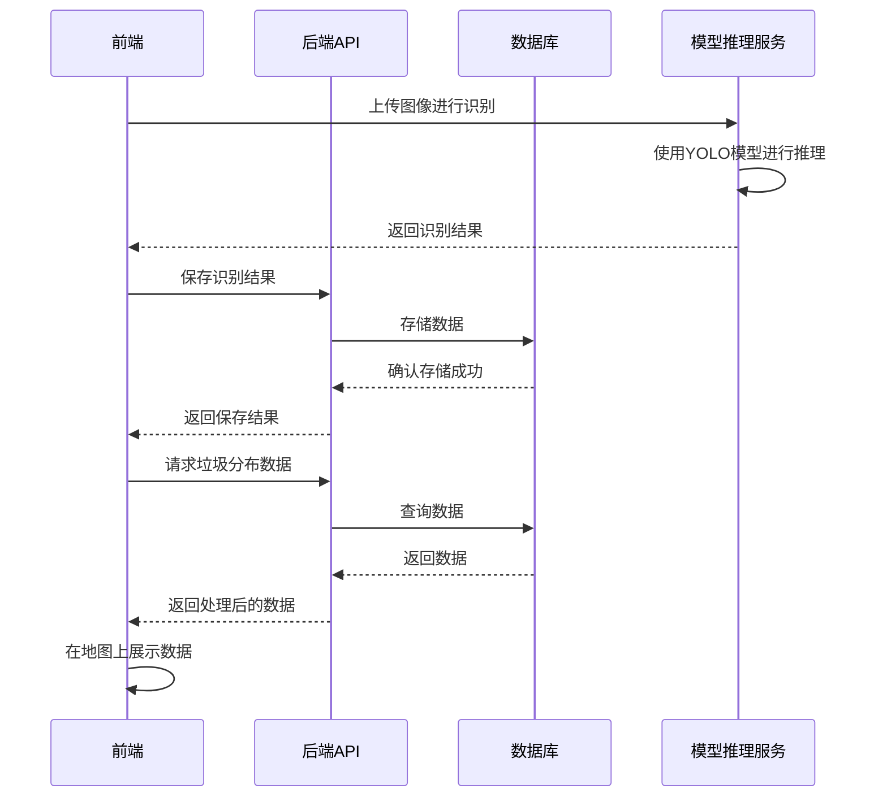

# 基于YOLO的海漂垃圾识别与可视化系统 - 产品需求文档

## 1. 产品概览

基于YOLO的海漂垃圾识别与可视化系统是一个集成了人工智能识别、数据管理和可视化展示的综合性平台。该系统通过YOLO模型对海漂垃圾进行智能识别，并将识别结果通过地图可视化的方式展示出来，帮助用户直观了解海洋垃圾的分布情况和变化趋势。

## 2. 核心功能

### 2.1 功能模块

本系统包含以下核心模块：

1. **垃圾识别模块**：使用YOLO模型对海洋垃圾进行实时识别
2. **数据管理模块**：存储、管理和查询垃圾识别数据
3. **可视化展示模块**：通过地图和图表展示垃圾分布、数量变化及热点区域
4. **用户管理模块**：管理系统用户和权限

### 2.2 详细功能

| 功能模块             | 功能描述                                                                                |
| -------------------- | --------------------------------------------------------------------------------------- |
| **垃圾识别**   | 通过FastAPI提供的推理服务，对上传的图像进行垃圾识别，返回识别结果（类型、位置、置信度） |
| **数据管理**   | 存储垃圾识别数据，支持按时间、类型、位置等条件进行查询和筛选                            |
| **地图可视化** | 在地图上展示垃圾分布点，支持缩放、平移等操作，显示热点区域                              |
| **数据统计**   | 生成垃圾数量变化趋势图、类型分布图等统计图表                                            |
| **用户管理**   | 支持用户注册、登录、权限管理等功能                                                      |
| **系统设置**   | 支持模型参数调整、系统配置等功能                                                        |

## 3. 用户角色

| 角色               | 权限                                                   |
| ------------------ | ------------------------------------------------------ |
| **普通用户** | 查看垃圾分布数据、查看统计图表、使用垃圾识别功能       |
| **管理员**   | 除普通用户权限外，还可管理用户、调整系统设置、导出数据 |

## 4. 技术架构

### 4.1 技术栈

- **后端**：Spring Boot 3 + MySQL8 + MyBatis
- **前端**：Vue3 + Vite + Pinia + Naive UI
- **模型推理**：FastAPI + YOLO
- **地图SDK**：百度地图

### 4.2 系统架构

## 5. 数据结构

### 5.1 垃圾数据

- id: 唯一标识
- type: 垃圾类型
- confidence: 识别置信度
- latitude: 纬度
- longitude: 经度
- timestamp: 识别时间
- image_url: 原始图像路径
- processed_image_url: 处理后带标注的图像路径

### 5.2 用户数据

- id: 唯一标识
- username: 用户名
- password: 密码（加密存储）
- role: 角色（普通用户/管理员）
- create_time: 创建时间

## 6. 性能要求

- 系统应在无GPU环境下流畅运行
- 模型推理响应时间应控制在合理范围内（视图像大小而定）
- 地图加载和数据渲染应流畅，无明显卡顿

## 7. 安全要求

- 用户密码应进行加密存储
- API接口应进行权限验证
- 图像上传应进行安全检查，防止恶意文件

## 8. 部署要求

- 支持容器化部署
- 提供详细的部署文档
- 支持环境变量配置

## 9. 开发计划

### 9.1 阶段一：需求分析与设计

- 完成产品需求文档
- 设计数据库Schema
- 确定技术架构和技术栈

### 9.2 阶段二：后端开发

- 搭建Spring Boot项目骨架
- 实现数据库连接和基础API
- 开发数据管理功能

### 9.3 阶段三：前端开发

- 搭建Vue3项目骨架
- 实现基础页面和组件
- 开发数据可视化功能

### 9.4 阶段四：模型开发

- 收集和标注海洋垃圾数据集
- 训练YOLO模型
- 搭建FastAPI推理服务

### 9.5 阶段五：集成与测试

- 集成前后端和模型服务
- 进行系统测试和性能优化
- 编写部署文档

### 9.6 阶段六：上线与维护

- 部署系统到生产环境
- 收集用户反馈并进行优化
- 定期更新模型和系统功能
